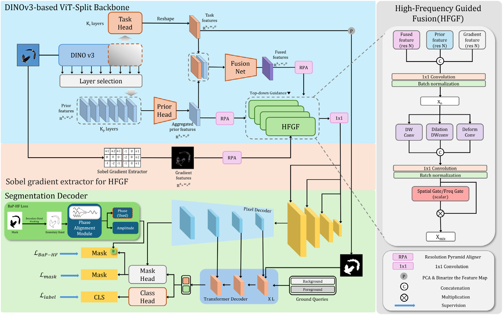
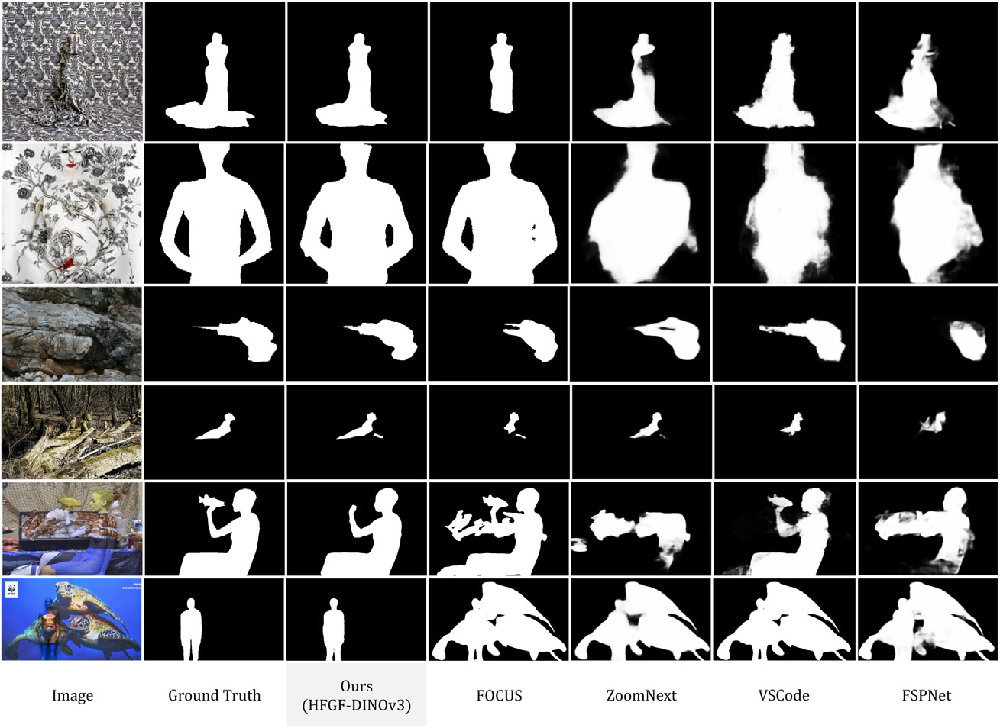

<div align="center">

<h1>HFGF-DINOv3</h1>

<h3>High-Frequency Guided Fusion and Phase-Aware Loss<br>for Camouflaged Object Detection</h3>

Jisang Lee<sup>1</sup> · Hyoungwon Seo<sup>1</sup> · Eunkyung Kim<sup>2&#42;</sup> · Haneol Jang<sup>1&#42;</sup>

<sup>1</sup>Dept. of Computer Engineering, <sup>2</sup>Dept. of Artificial Intelligence Software, Hanbat National University<br>
<sup>&#42;</sup>Corresponding authors

***Pattern Recognition*, Vol. 183, 115066 (2027)**

[](https://doi.org/10.1016/j.patcog.2026.115066)
[](LICENSE)
[](#installation)
[](#installation)

</div>

<p align="center"></p>

HFGF-DINOv3 adapts the self-supervised vision foundation model **DINOv3** to camouflaged object detection (COD), where foreground and background share low-frequency statistics and the boundary is the main cue.

- **RoPE-consistent ViT-Split adaptation.** A copied task head and a layer-selected prior head adapt DINOv3 ViT-H+/16 without breaking its RoPE positional geometry.
- **High-Frequency Guided Fusion (HFGF) neck.** A Sobel gradient prior and spatial/frequency dual gating rebuild a boundary-sensitive feature pyramid.
- **Boundary-aware Phase High-Frequency (BaP-HF) loss.** Phase alignment in high-frequency bands inside the boundary band; used only during training, so inference cost is unchanged.

On CAMO, HFGF-DINOv3 reaches S<sub>m</sub> / E<sub>ξ</sub> / F<sup>w</sup><sub>β</sub> of **0.920 / 0.969 / 0.917** and MAE **0.021**, improving on FOCUS (AAAI 2025) by +0.008 / +0.006 / +0.013 and −0.004.

## News

- **2026-10** Code released.
- **2026-10** Paper published in *Pattern Recognition* ([DOI](https://doi.org/10.1016/j.patcog.2026.115066)).

## Results

Mean ± std over three runs (seeds 42, 84, 126), from Tables 1 and 2 of the paper.

| Dataset | Test images | S<sub>m</sub> ↑ | E<sub>ξ</sub> ↑ | F<sup>w</sup><sub>β</sub> ↑ | MAE ↓ |
|:--|--:|:-:|:-:|:-:|:-:|
| CAMO | 250 | 0.920 ± 0.000 | 0.969 ± 0.001 | 0.917 ± 0.001 | 0.021 ± 0.001 |
| COD10K | 2,026 | 0.916 ± 0.001 | 0.976 ± 0.000 | 0.894 ± 0.000 | 0.012 ± 0.000 |
| NC4K | 4,121 | 0.917 ± 0.000 | 0.966 ± 0.001 | 0.910 ± 0.001 | 0.020 ± 0.001 |
| CHAMELEON | 76 | 0.927 ± 0.001 | 0.977 ± 0.001 | 0.921 ± 0.002 | 0.014 ± 0.001 |

The model is trained once on CAMO + COD10K; NC4K and CHAMELEON are evaluated without fine-tuning.

<details>
<summary>Qualitative comparison (Fig. 4)</summary>
<p align="center"></p>
</details>

## Installation

Tested on Linux with 3 × NVIDIA RTX A6000 (48 GB).

| Python | PyTorch | torchvision | CUDA | Detectron2 |
|:-:|:-:|:-:|:-:|:-:|
| 3.8.20 | 2.1.1 | 0.16.1 | 11.8 | [`525208d`](https://github.com/facebookresearch/detectron2/tree/525208d9d6b36c72500183470fd181848b822468) |

```bash
git clone https://github.com/Kkubuck/HFGF-DINOv3.git
cd HFGF-DINOv3

conda create -n hfgf-dinov3 python=3.8.20 pip=24.0 -y
conda activate hfgf-dinov3
pip install torch==2.1.1 torchvision==0.16.1 --index-url https://download.pytorch.org/whl/cu118
pip install -r requirements.txt

# Detectron2 (pinned commit)
git clone https://github.com/facebookresearch/detectron2.git third_party/detectron2
git -C third_party/detectron2 checkout 525208d9d6b36c72500183470fd181848b822468
pip install --no-build-isolation -e third_party/detectron2

# Multi-scale deformable attention (CUDA op)
cd hfgf_dinov3/modeling/pixel_decoder/ops && pip install --no-build-isolation . && cd -
```

Building the two extensions requires the CUDA 11.8 toolkit (`nvcc`) and a matching C++ compiler. The DINOv3 backbone code ships in [`third_party/dinov3`](third_party/dinov3); no separate DINOv3 install is needed.

## Data preparation

Download the benchmarks from their official sources and place them under `datasets/`:

| Dataset | Train | Test | Source |
|:--|--:|--:|:--|
| CAMO | 1,000 | 250 | [CAMO](https://sites.google.com/view/ltnghia/research/camo) |
| COD10K | 3,040 | 2,026 | [COD10K](https://github.com/DengPingFan/SINet) |
| NC4K | — | 4,121 | [NC4K](https://github.com/JingZhang617/COD-Rank-Localize-and-Segment) |
| CHAMELEON | — | 76 | [CHAMELEON](https://www.polsl.pl/rau6/datasets/) |

```text
datasets/
├── CAMO-V.1.0-CVIU2019/
│   ├── Images/{Train,Test}/
│   └── GT/
├── COD10K-v3/
│   ├── Train/{Image,GT_Object}/
│   └── Test/{Image,GT_Object}/
├── NC4K/{Imgs,GT}/
└── CHAMELEON/{Imgs,GT}/
```

Generate the Detectron2 annotations (raw masks are not modified) and point Detectron2 to the folder:

```bash
python tools/prepare_datasets.py --root datasets
export DETECTRON2_DATASETS=$(pwd)/datasets
```

## Training

Request the **DINOv3 ViT-H+/16 (LVD-1689M)** weights from the [official DINOv3 release](https://github.com/facebookresearch/dinov3#pretrained-models) and save the `.pth` file in `checkpoints/`.

```bash
python train_net.py --config-file configs/hfgf_dinov3.yaml --num-gpus 3 \
  MODEL.BACKBONE_WEIGHTS checkpoints/dinov3_vith16plus_pretrain_lvd1689m-7c1da9a5.pth
```

| Setting | Value |
|:--|:--|
| Training data | CAMO train + COD10K train (4,040 images) |
| Optimizer | AdamW, weight decay 0.05, poly schedule (power 0.9), AMP |
| Learning rate | backbone 1e-5 / head 1e-4 |
| Batch × iterations | 9 (3 GPUs × 3) × 17,778 — the paper's 8 × 20,000 sample budget (≈160k images) |
| BaP-HF | weight 0.1 from iteration 2,000; h<sub>p</sub> = 0.25, k = 3 |

Checkpoints and logs go to `outputs/hfgf_dinov3/`; add `--resume` to continue an interrupted run. The paper reports the mean of three runs: append `SEED 84 OUTPUT_DIR outputs/hfgf_dinov3_s84` (and likewise for 126).

## Evaluation

Evaluate a trained checkpoint on CAMO, COD10K, NC4K and CHAMELEON:

```bash
python train_net.py --config-file configs/hfgf_dinov3.yaml --num-gpus 3 --eval-only \
  MODEL.WEIGHTS outputs/hfgf_dinov3/model_final.pth
```

Test images are resized to a shorter side of 512 (longer side ≤ 2,048), and the merged foreground mask is restored to the original resolution. Metrics are written to `outputs/hfgf_dinov3/inference/<dataset>/metrics.json` together with per-image scores.

## Inference

Predict binary masks for an image or a folder:

```bash
python tools/predict.py --checkpoint outputs/hfgf_dinov3/model_final.pth \
  --input path/to/images --output predictions/
```

Saved masks can be scored with the same protocol (`cod_val` = CAMO, `cod10k_val`, `nc4k`, `chameleon`):

```bash
python tools/evaluate_predictions.py --dataset cod_val --predictions predictions/ --dataset-root datasets
```

## Code structure

| Paper | Code |
|:--|:--|
| DINOv3 ViT-Split backbone (Sec. 3.1), Sobel prior (Alg. 1) | [`hfgf_dinov3/modeling/backbone/vit_split.py`](hfgf_dinov3/modeling/backbone/vit_split.py) |
| HFGF block with spatial / frequency gates (Sec. 3.2, Alg. 2) | [`hfgf_dinov3/modeling/backbone/hfgf.py`](hfgf_dinov3/modeling/backbone/hfgf.py) |
| BaP-HF loss (Sec. 3.3, Eqs. 7–13) | [`hfgf_dinov3/modeling/bap_hf_loss.py`](hfgf_dinov3/modeling/bap_hf_loss.py) |
| Total loss (Eq. 14) | [`hfgf_dinov3/modeling/criterion.py`](hfgf_dinov3/modeling/criterion.py) |
| Query decoder (Mask2Former, two queries) | [`hfgf_dinov3/modeling/hfgf_dinov3.py`](hfgf_dinov3/modeling/hfgf_dinov3.py), [`transformer_decoder/`](hfgf_dinov3/modeling/transformer_decoder) |
| S<sub>m</sub>, E<sub>ξ</sub>, F<sup>w</sup><sub>β</sub>, MAE (Eqs. 15–21) | [`hfgf_dinov3/evaluation/metrics.py`](hfgf_dinov3/evaluation/metrics.py) |

<details>
<summary>Ablation switches</summary>

Append these overrides to the training command.

| Variant | Override |
|:--|:--|
| Without HFGF (residual fusion) | `MODEL.VITSPLIT.FUSION_MODE residual` |
| Without BaP-HF | `MODEL.MASK_FORMER.BAPHF_WEIGHT 0.0` |
| Full backbone learning rate | `SOLVER.BACKBONE_MULTIPLIER 1.0` |
| Spatial gate only / frequency gate only (Table 4) | `MODEL.VITSPLIT.HFGF_ENABLE_FREQ False` / `MODEL.VITSPLIT.HFGF_ENABLE_SPATIAL False` |
| BaP-HF cutoff h<sub>p</sub> and band kernel k (Table 5) | `MODEL.MASK_FORMER.BAPHF_HIGHPASS 0.35` / `MODEL.MASK_FORMER.BAPHF_BAND_KERNEL 5` |

</details>

```text
HFGF-DINOv3/
├── configs/hfgf_dinov3.yaml      # paper recipe
├── hfgf_dinov3/
│   ├── config.py, checkpoint.py  # config keys, DINOv3 initialization, strict loading
│   ├── data/                     # benchmark registration and augmentation
│   ├── evaluation/               # COD evaluator and metrics
│   └── modeling/                 # backbone, HFGF, BaP-HF, Mask2Former decoder
├── third_party/dinov3/           # DINOv3 ViT runtime (DINOv3 License)
├── tools/                        # prepare_datasets, predict, evaluate_predictions
├── tests/                        # CPU unit tests: python -m unittest discover -s tests
└── train_net.py                  # training and --eval-only evaluation
```

## Citation

```bibtex
@article{lee2027hfgfdinov3,
  title   = {{HFGF-DINOv3}: High-Frequency Guided Fusion and phase-aware loss for camouflaged object detection},
  author  = {Lee, Jisang and Seo, Hyoungwon and Kim, Eunkyung and Jang, Haneol},
  journal = {Pattern Recognition},
  volume  = {183},
  pages   = {115066},
  year    = {2027},
  doi     = {10.1016/j.patcog.2026.115066}
}
```

## Acknowledgements

This code builds on [FOCUS](https://github.com/geshang777/FOCUS), [Mask2Former](https://github.com/facebookresearch/Mask2Former), [Detectron2](https://github.com/facebookresearch/detectron2), [DINOv3](https://github.com/facebookresearch/dinov3) and [ViT-Split](https://github.com/JackYFL/ViT-Split). We thank the authors for releasing their code.

## License

The code is released under the [Apache License 2.0](LICENSE). The DINOv3 runtime in `third_party/dinov3/` and the DINOv3 weights are governed by the [DINOv3 License](third_party/dinov3/LICENSE.md). Other upstream components keep their licenses; see [THIRD_PARTY_NOTICES.md](THIRD_PARTY_NOTICES.md).
